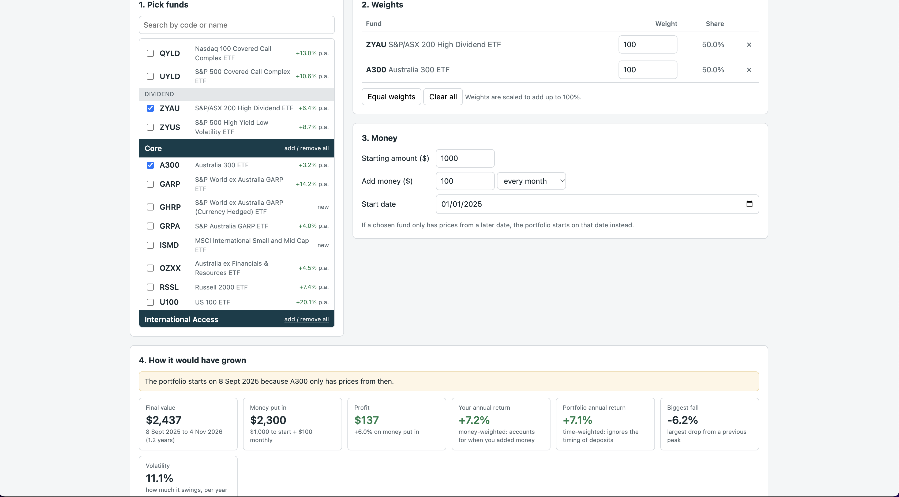

# ETF Analyser

A Python tool that reads a list of ETFs from a spreadsheet, downloads their price history and shows how they've performed. It saves an Excel report and an interactive page where you can build a portfolio.

## What it produces

- **etf_results.xlsx**: funds grouped under your headings, a sortable sheet of all funds, a sector summary, a correlation table and charts
- **etf_portfolio_builder.html**: open it in your browser to pick ETFs, set weights, add money regularly and see how the portfolio would have grown
- **growth_chart.png** and **risk_return_chart.png**
-    

For each fund it calculates total return, annual return, volatility, maximum drawdown and return per unit of risk. Prices are adjusted for distributions, so returns are total returns.

## Setup

1. Install [Python 3](https://www.python.org/downloads/)
2. Download these files into one folder
3. In Terminal, go into that folder and run:

```
pip3 install -r requirements.txt
```

## Run it

```
python3 etf_analyser.py
```

Run it again any time to refresh the prices. The "as of" date and time is shown in the results.

## Choosing your funds

The funds come from `funds.xlsx`. It starts with Global X Australia 53 ETFs (Fund Map, July 2026). Edit the spreadsheet to analyse different ETFs:

| Column | Notes |
| --- | --- |
| Ticker | Required, e.g. `VAS` |
| Name | Optional |
| Heading / Sub-heading | Optional, used for grouping |
| Exchange | ASX (default), TMX Australia or US |
| Yahoo symbol | Only needed for other exchanges |

To keep a separate list, save it as its own file and run:

```
python3 etf_analyser.py --funds mylist.xlsx --out mylist
```

## Options

| Option | What it does |
| --- | --- |
| `--period 3y` | Change the history window (1y, 3y, 5y, max) |
| `--tickers GXAI SEMI` | Analyse only these funds from your list |
| `--chart-top 0` | Show every fund on the growth chart |
| `--common-start` | Start the growth chart on the first date all funds have data |

## Notes

- Price data comes from Yahoo Finance via the `yfinance` library. 
- Funds Yahoo has no price history for are still listed, marked "No price data found".
- Past performance does not predict future performance. This is not financial advice.
